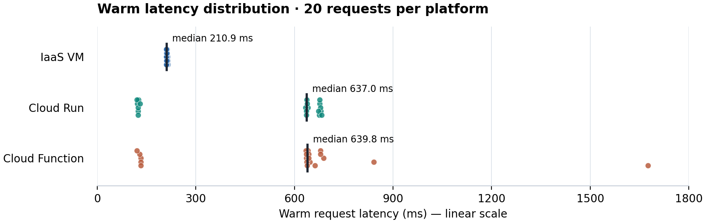

# Phase 1 — Comparison Report

## 1. Setup facts

**Image size in MB** (Artifact Registry size divided by 1,000,000):

<!--answer:image_size_mb-->
49.989425
<!--/answer-->

**Custom VPC name:**

<!--answer:vpc_name-->
echo-net
<!--/answer-->

**Custom subnet name:**

<!--answer:subnet_name-->
echo-subnet
<!--/answer-->

---

## 2. Measurements

All values below are copied from `submission/phase1_report.json`.

| Platform | Cold (ms) | Warm median (ms) |
|---|---|---|
| IaaS VM | <!--answer:vm_cold_ms-->250.8<!--/answer--> | <!--answer:vm_warm_median_ms-->210.9<!--/answer--> |
| Cloud Run | <!--answer:cloudrun_cold_ms-->3149.6<!--/answer--> | <!--answer:cloudrun_warm_median_ms-->637.0<!--/answer--> |
| Cloud Function | <!--answer:function_cold_ms-->2225.2<!--/answer--> | <!--answer:function_warm_median_ms-->639.8<!--/answer--> |

<!--answer:latency_plot-->


Each dot represents one warm request; vertical marks show medians. VM samples range from 209.8 to 214.6 ms, Cloud Run from 120.4 to 683.0 ms, and Function from 121.2 to 1675.5 ms. The two managed services show clusters of lower and higher latencies; this experiment does not establish their cause.

The first request was measured after leaving the endpoints idle for approximately 20 minutes. The script labels it “cold” but does not force or verify scale-to-zero. For the continuously running VM it is a first-request measurement, not a container cold start. All timings include network and HTTP handling; managed endpoints also use HTTPS, while the VM uses HTTP.
<!--/answer-->

---

## 3. Per-platform analysis

**Scaling behaviour**

<!--answer:scaling_behaviour-->
The VM creates no additional instances automatically: one, ten or a hundred simultaneous requests share the same `e2-micro` and its single container, with one Gunicorn worker and eight threads. Capacity is constrained by those resources. Cloud Run and the gen-2 Function can automatically create additional container instances as demand increases, with a configured maximum of three per deployment (`--max-instances=3`) and a minimum of zero. Scaling is not instantaneous; bursts may queue or be rejected when capacity is exhausted. The Function is configured for one concurrent request per instance.
<!--/answer-->

**Deployment effort**

<!--answer:deployment_effort-->
All paths reuse the same Python echo logic. I completed two functions, a multi-stage Dockerfile, and ran unit tests. Cloud Build built the image and pushed it to Artifact Registry after I configured build permissions. For the VM, I created a custom VPC, subnet and tagged firewall rules for TCP 8080 and 22, provisioned Debian, installed Docker, authenticated, pulled and launched the container. The `echo-http` tag selects which VMs receive those rules. Cloud Run required the image and deployment settings. The Function required source, dependencies, runtime and entry point; Google handled packaging. The VM additionally requires OS maintenance, and its external IPv4 incurs charges under the lab's stated rules.
<!--/answer-->

---

## 4. Why do two of your three numbers look alike?

**Complete output of the Cloud Run services listing captured while both services were deployed:**

<!--answer:run_services_list-->
```text
✔
SERVICE: echo
REGION: us-central1
URL: https://echo-1085360423627.us-central1.run.app
LAST DEPLOYED BY: service-1085360423627@gcf-admin-robot.iam.gserviceaccount.com
LAST DEPLOYED AT: 2026-10-20T11:59:27.782327Z

✔
SERVICE: echo-bot
REGION: us-central1
URL: https://echo-bot-1085360423627.us-central1.run.app
LAST DEPLOYED BY: carlo.sorrentino@eurecom.fr
LAST DEPLOYED AT: 2026-10-20T11:26:55.839896Z
```
<!--/answer-->

**Explanation**

<!--answer:convergence_explanation-->
The listing shows both `echo-bot`, deployed directly by me, and `echo`, deployed by the Cloud Functions service agent. The gen-2 Function therefore runs as a Cloud Run service underneath. Both managed paths execute containers, can scale to zero, and may require initialization before serving the first request. Their warm medians are almost identical (637.0 and 639.8 ms), while first-request times differ (3149.6 and 2225.2 ms). Shared infrastructure makes similar behaviour plausible, without guaranteeing identical latency. The deployment interface differs: Cloud Run receives my prebuilt image; Functions receives Python source and builds its own image around the HTTP entry point. Configurations also differ: Cloud Run has 1 vCPU, while the Function reports approximately 0.1666 vCPU and concurrency 1. These are end-to-end observations, not an isolated benchmark of platform overhead.
<!--/answer-->
